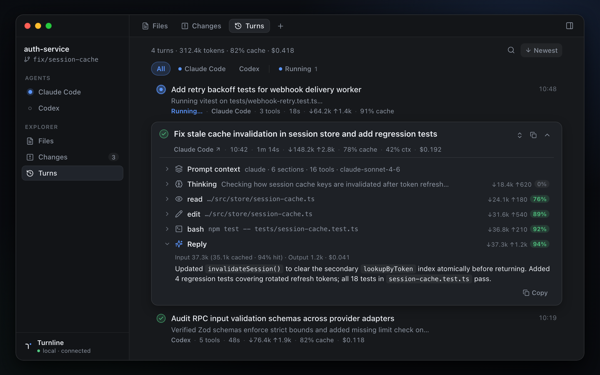
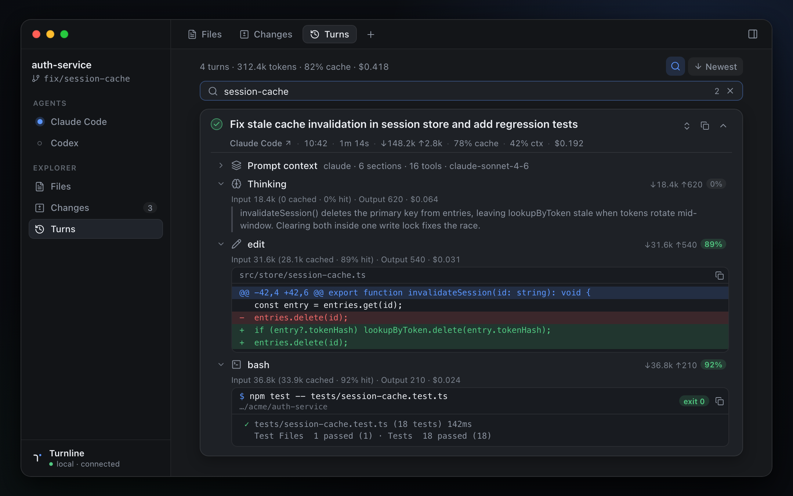

<p align="center">
  
</p>

<h1 align="center">Turnline</h1>

<p align="center">
  <strong>Full-trace turn inspector for <a href="https://paseo.sh">Paseo</a> coding agents.</strong><br />
  Inspect prompts, thinking, tool diffs, token usage, cache hit rates, cost, and prompt context on one live timeline.
</p>

<p align="center">
  <a href="#install">Install</a> ·
  <a href="#features">Features</a> ·
  <a href="#provider-support">Provider Support</a> ·
  <a href="#development">Development</a>
</p>

<p align="center">
  
</p>
<p align="center">
  
  
</p>

## Features

- **Live turn timeline** — Groups every prompt, thinking block, tool call, and reply into expandable cards inside the workspace **Turns** panel, explorer, and Command Center (`Open turn inspector`).
- **Per-step cost & cache visibility** — Tracks duration, input/output tokens, prompt cache hit rate, context window usage, and USD cost across the workspace, each turn, and individual LLM steps.
- **Deep execution trace** — Inspect reasoning blocks, syntax-highlighted diffs, shell commands with exit codes, file reads, and errors with one-click copy.
- **Prompt context inspector** — Expand **Prompt context** on any turn to inspect the effective model, system prompt sections, declared or observed tools, and full context messages on demand.
- **Fast search & filtering** — Filter by agent or status (`Running`, `Failed`), search prompts, tools, and files, flip newest/oldest sorting per tab, and load older history on demand.

## Install

```bash
paseo plugin install github:versun/paseo-turnline
```

**Requirements:** Paseo `>= 0.15.4` with plugins enabled (plus `sqlite3` on the daemon `PATH` for Devin CLI or Antigravity sessions).

<details>
<summary>Install from a local clone</summary>

```bash
git clone https://github.com/versun/paseo-turnline.git
cd paseo-turnline && npm install
paseo plugin install "$(pwd)"
```

</details>

## Provider Support

Turn grouping and timeline traces work across **all Paseo providers**. For the providers below, Turnline reads local session files directly on your daemon host (no external requests) to unlock prompt context and per-step token/cache metrics:

| Provider | Prompt replay | Tools | Per-step usage | Local store |
| --- | --- | --- | --- | --- |
| **Claude Code** | Historical (`at`) | Declared / observed | Yes | `~/.claude/projects/` (`CLAUDE_CONFIG_DIR`) |
| **Codex** | Historical (`at`) | Observed | Yes | `~/.codex/{sessions,archived_sessions}/` (`CODEX_HOME`) |
| **pi** | Historical (`at`) | Declared | Yes | `~/.pi/agent/sessions/` |
| **Devin CLI** | Historical (`at`) | — | Yes | `~/.local/share/devin/cli/sessions.db` (`XDG_DATA_HOME`) |
| **Antigravity** | Latest snapshot | Observed | Yes | `~/.gemini/antigravity-cli/conversations/<id>.db` |
| **Other providers** | — | — | Turn-level only | Canonical Paseo timeline |

## Development

```bash
npm install
npm run typecheck && npm test
paseo plugin reload turnline
```
