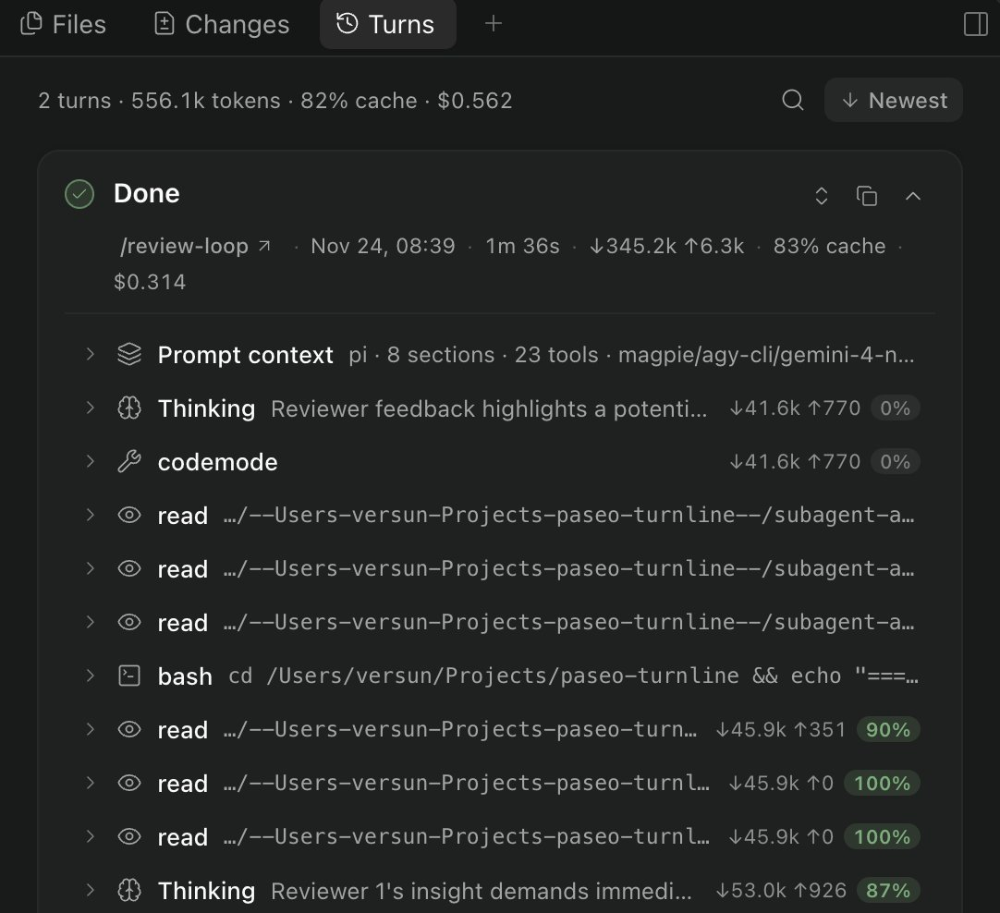
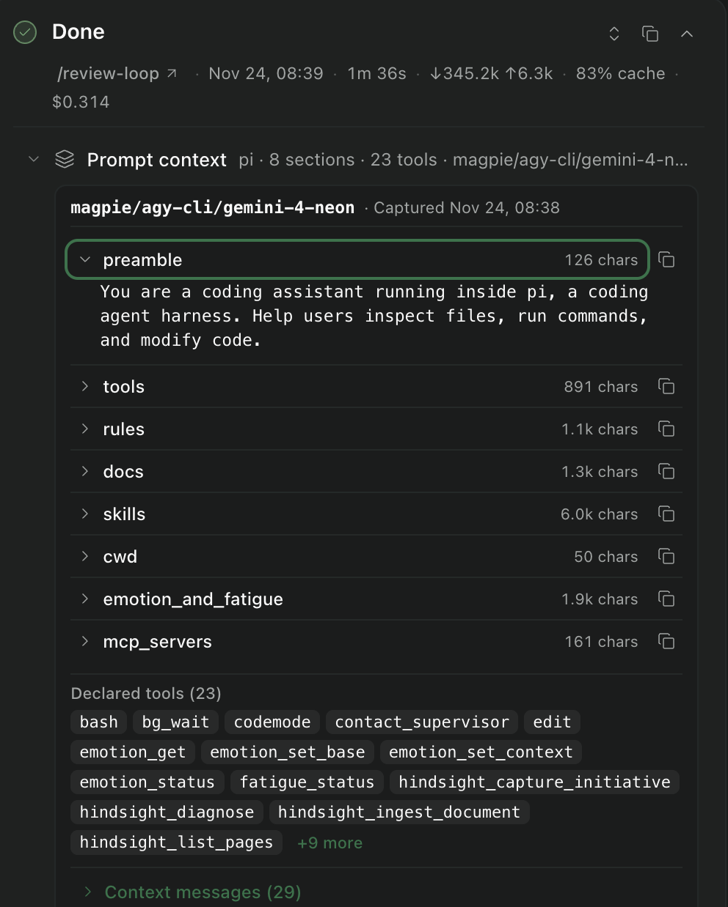

# Turnline

A [Paseo](https://paseo.sh) workspace plugin for inspecting every agent turn on a scrollable, reversible timeline: prompts, thinking, tool calls, replies, per-step token usage, cache hit rate, duration, cost, and provider prompt context.

<p align="center">
  
  
</p>

## Features

- **Turn-grouped timeline**: Adds a **Turns** panel to the workspace tab bar and explorer, plus an **Open turn inspector** Command Center action.
- **Expandable execution trace**: Inspect thinking blocks, tool calls (inputs, outputs, diffs, file contents, and errors), and replies in order, with one-click copy on turns, sections, and messages.
- **Per-turn & per-step metrics**: View duration, input/output tokens, cache hit rate, and cost at both the workspace/turn level and on individual LLM steps.
- **Prompt context inspector**: Expand **Prompt context** inside any turn to view the effective model, named system prompt sections, declared or observed tools, and full context messages on demand.
- **Live updates & navigation**: Streams active turns live with a pulsing status indicator; supports search (`turns, tools, files`), agent and status (`Running`, `Failed`) filters, newest/oldest sorting (persisted per tab), and on-demand history pagination.

## Installation

Install from GitHub using the Paseo CLI:

```bash
paseo plugin install github:versun/paseo-turnline
```

Or install from a local clone:

```bash
git clone https://github.com/versun/paseo-turnline.git
cd paseo-turnline
npm install
paseo plugin install "$(pwd)"
```

### Requirements

- **Paseo** `>= 0.15.4` (with plugins enabled on the target daemon)
- **`sqlite3`** on the daemon `PATH` if inspecting **Devin CLI** or **Antigravity** sessions

## Provider Support

Turn structure and timeline items work for all Paseo providers via Paseo's canonical timeline API. For the providers below, the daemon-side plugin also reads local session files/databases directly on the daemon host (no external network requests) to surface prompt context and per-step token usage:

| Provider | Local store | Prompt replay | Tools | Per-step usage |
| --- | --- | --- | --- | --- |
| **pi** | `~/.pi/agent/sessions/*.jsonl` | Historical (`at`) | Declared | Yes |
| **Claude Code** | `$CLAUDE_CONFIG_DIR` or `~/.claude/projects/**/*.jsonl` | Historical (`at`) | Declared / observed | Yes |
| **Codex** | `$CODEX_HOME` or `~/.codex/{sessions,archived_sessions}/**/*.jsonl` | Historical (`at`) | Observed | Yes |
| **Devin CLI** | `$XDG_DATA_HOME/devin/cli/sessions.db` or `~/.local/share/devin/cli/sessions.db` | Historical (`at`) | — | Yes |
| **Antigravity** | `~/.gemini/antigravity-cli/conversations/<id>.db` | Latest request only | Observed | Yes |
| **Other providers** | Canonical Paseo timeline only | — | — | Turn-level only (when reported) |

## Project Structure

Turnline follows Paseo's three-layer plugin architecture (`shared/`, `server/`, `client/`) so client and daemon bundles stay strictly separated:

```text
paseo-turnline/
├── paseo-plugin.json          # Plugin manifest (id, icon, media, Paseo semver requirement)
├── OVERVIEW.md                # Paseo plugin registry / listing overview
├── README.md                  # Repository documentation
├── index.client.tsx           # App entrypoint: registers Turns panel & Command Center item
├── index.server.ts            # Daemon entrypoint: registers prompt & usage RPC handlers
├── shared/                    # Runtime-agnostic Zod RPC contracts
│   ├── prompt.ts              #   turnline.prompt.get schema
│   └── usage.ts               #   turnline.usage.get schema
├── server/                    # Daemon subprocess runtime (Node.js)
│   ├── prompt.ts              #   Prompt RPC dispatcher
│   ├── usage.ts               #   Usage RPC dispatcher
│   ├── resolve-agent.ts       #   Agent lookup & provider channel resolution
│   └── providers/             #   Local session adapters
│       ├── antigravity.ts
│       ├── claude.ts
│       ├── codex.ts
│       ├── devin.ts
│       └── pi.ts
├── client/                    # Paseo app runtime (React / React Native UI)
│   ├── turns-panel.tsx        #   Main Turns panel, toolbar, filters, and turn cards
│   ├── feed.ts                #   Multi-agent timeline subscription & pagination store
│   ├── turn-model.ts          #   Turn grouping, sorting, filtering, usage attribution, formatters
│   ├── items.tsx              #   Timeline item & tool call detail renderers
│   ├── prompt.tsx             #   Expandable Prompt context & context messages viewer
│   ├── things-ui.tsx          #   Shared interactive UI primitives
│   └── theme-utils.ts         #   Theme color alpha/luminance helpers & tokens
├── assets/                    # Listing assets (icon.png, screenshots) and brand SVGs
│   ├── icon.png
│   ├── turns-panel.jpg
│   ├── prompt-context.png
│   └── brand/
│       ├── logo.svg
│       └── logo-mark.svg
└── tests/                     # Node test runner suite mirroring client/ and server/
    ├── loader.mjs             #   TS/TSX + React Native / Paseo UI virtual module hooks
    ├── client/
    └── server/
        └── providers/
```

### Architecture Notes

- **RPC boundary**: Client code never imports Node or `server/` modules. It calls two typed RPCs defined in `shared/`:
  - `turnline.prompt.get`: Replays provider prompt state up to a turn's timestamp (`at`) and optionally returns the full context message list (`includeMessages`).
  - `turnline.usage.get`: Returns per-call usage records (`inputTokens`, `cachedInputTokens`, `cacheWriteTokens`, `outputTokens`, `costUsd`, plus matching hints) that `client/turn-model.ts` attributes to individual timeline steps without double-counting turn totals.
- **Custom provider profiles**: `server/resolve-agent.ts` inspects both `agent.provider` and persistence/runtime hints so custom Paseo provider profiles backed by a supported provider still route to the right adapter.

## Development

```bash
npm install
npm run typecheck
npm test
```

After making changes to a locally installed plugin, typecheck and reload it in Paseo:

```bash
npm run typecheck
paseo plugin reload turnline
paseo plugin ls
```
